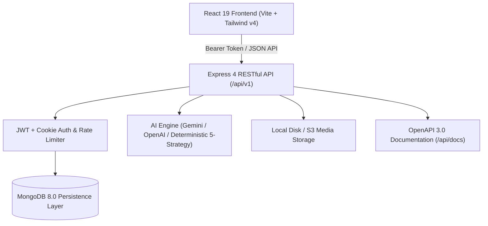

# BhaktiGrow AI — Production Full-Stack Devotional Growth Platform

[](https://frontend-chi-indol-27.vercel.app)
[](https://github.com/Ritikgupta-tech/bhaktigrow-ai.git)
[](https://reactjs.org/)
[](https://www.typescriptlang.org/)
[](https://nodejs.org/)
[](https://expressjs.com/)
[](https://www.mongodb.com/)
[-brightgreen.svg)](https://vitest.dev/)
[](LICENSE)

**BhaktiGrow AI** is an AI-powered devotional content strategy and optimization SaaS platform designed specifically for Sanatan creators publishing on **YouTube**, **Instagram**, and **Facebook**. 

- **Live Deployed Web Application**: [https://frontend-chi-indol-27.vercel.app](https://frontend-chi-indol-27.vercel.app)
- **Official GitHub Repository**: [https://github.com/Ritikgupta-tech/bhaktigrow-ai.git](https://github.com/Ritikgupta-tech/bhaktigrow-ai.git)
- **Default Production Branch**: `main`

---

## 🏗️ System Architecture



### Monorepo Structure

```
bhaktigrow-ai/
├── frontend/                 # React 19 + TypeScript + Vite SPA
│   ├── src/
│   │   ├── components/      # UI components, layout, devotional icons
│   │   ├── context/         # Auth, SavedItems, Calendar, Toast, Preferences
│   │   ├── lib/             # API client, suggestion engine, video validator
│   │   ├── pages/           # 12 core SaaS pages + 4 Auth pages
│   │   ├── test/            # 29 Vitest + React Testing Library tests
│   │   └── types/           # Strongly typed models and contracts
├── backend/                  # Express 4 + TypeScript Node.js server
│   ├── src/
│   │   ├── config/          # Zod-validated env and Mongoose connection
│   │   ├── controllers/     # Auth, Content, AI, Suggestions, Calendar, Media, Analytics
│   │   ├── middleware/      # JWT auth, Zod validation, error handler, rate limiter
│   │   ├── models/          # User, ContentDraft, SavedSuggestion, Calendar, Media
│   │   ├── routes/          # Express route definitions
│   │   ├── services/        # AI orchestration, local file storage, OAuth status
│   │   ├── docs/            # Swagger OpenAPI 3.0 documentation
│   │   └── test/            # 18 Vitest integration & security tests
├── shared/                   # Shared TypeScript interfaces & DTOs
├── .env.example              # Comprehensive environment configuration template
├── render.yaml               # Render Blueprint backend deployment configuration
└── README.md                 # Complete documentation and setup guide
```

---

## 🌐 Production Deployment

### Frontend (Live on Vercel)
- **Production URL**: [https://frontend-chi-indol-27.vercel.app](https://frontend-chi-indol-27.vercel.app)
- **Framework**: Vite
- **Build Command**: `npm run build`
- **Output Directory**: `dist`
- **SPA Routing**: Configured via `vercel.json` rewrites and `_redirects`

### Backend (Render Blueprint Ready)
1. In the [Render Dashboard](https://dashboard.render.com), click **New** -> **Blueprint**.
2. Connect repository `https://github.com/Ritikgupta-tech/bhaktigrow-ai.git`.
3. Render automatically detects `render.yaml` with:
   - Root Directory: `backend`
   - Build Command: `npm install && npm run build`
   - Start Command: `node dist/index.js`
   - Health Check: `/api/v1/health`
4. Set your production environment variables:
   - `MONGODB_URI`: Your MongoDB Atlas connection URI (`mongodb+srv://...`)
   - `CLIENT_ORIGIN`: `https://frontend-chi-indol-27.vercel.app`
   - `AI_PROVIDER`: `gemini` or `mock`
   - `GEMINI_API_KEY`: Your Google AI Studio API key (optional)

---

## 🧪 Automated Test Verification

All **47 automated tests** pass with 100% success rate:
- **Backend**: 18 passed across 6 test suites (`health`, `auth`, `content`, `suggestions`, `ai`, `calendar`).
- **Frontend**: 29 passed across 5 test suites (`integration`, `suggestionEngine`, `videoValidator`, `savedItems`, `calendar`).
- **Production Builds**: Frontend (Vite) and Backend (tsc) compile with 0 errors.

---

## 📜 License

MIT License. Designed and engineered for devotional content creators worldwide.
