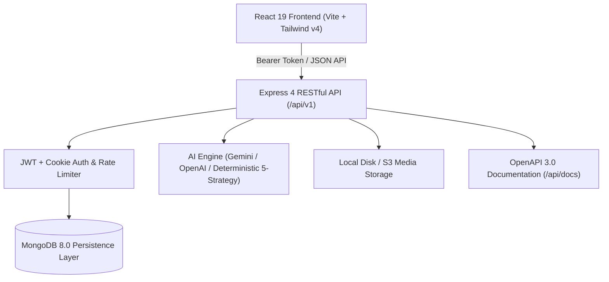

# BhaktiGrow AI — Production Full-Stack Devotional Growth Platform

[](https://frontend-chi-indol-27.vercel.app)
[](https://github.com/Ritikgupta-tech/bhaktigrow-ai.git)
[](https://reactjs.org/)
[](https://www.typescriptlang.org/)
[](https://nodejs.org/)
[](https://expressjs.com/)
[](https://www.mongodb.com/)
[-brightgreen.svg)](https://vitest.dev/)
[](LICENSE)

**BhaktiGrow AI** is an AI-powered devotional content strategy and optimization SaaS platform designed specifically for Sanatan creators publishing on **YouTube**, **Instagram**, and **Facebook**. 

- **Live Deployed Web Application**: [https://frontend-chi-indol-27.vercel.app](https://frontend-chi-indol-27.vercel.app)
- **Official GitHub Repository**: [https://github.com/Ritikgupta-tech/bhaktigrow-ai.git](https://github.com/Ritikgupta-tech/bhaktigrow-ai.git)
- **Default Production Branch**: `main`

---

## 🏗️ System Architecture



### Monorepo Structure

```
bhaktigrow-ai/
├── frontend/                 # React 19 + TypeScript + Vite SPA
│   ├── src/
│   │   ├── components/      # UI components, layout, devotional icons
│   │   ├── context/         # Auth, SavedItems, Calendar, Toast, Preferences
│   │   ├── lib/             # API client, suggestion engine, video validator
│   │   ├── pages/           # 12 core SaaS pages + 4 Auth pages
│   │   ├── test/            # 29 Vitest + React Testing Library tests
│   │   └── types/           # Strongly typed models and contracts
├── backend/                  # Express 4 + TypeScript Node.js server
│   ├── src/
│   │   ├── config/          # Zod-validated env and Mongoose connection
│   │   ├── controllers/     # Auth, Content, AI, Suggestions, Calendar, Media, Analytics
│   │   ├── middleware/      # JWT auth, Zod validation, error handler, rate limiter
│   │   ├── models/          # User, ContentDraft, SavedSuggestion, Calendar, Media
│   │   ├── routes/          # Express route definitions
│   │   ├── services/        # AI orchestration, local file storage, OAuth status
│   │   ├── docs/            # Swagger OpenAPI 3.0 documentation
│   │   └── test/            # 18 Vitest integration & security tests
├── shared/                   # Shared TypeScript interfaces & DTOs
├── .env.example              # Comprehensive environment configuration template
└── README.md                 # Complete documentation and setup guide
```

---

## 🌟 Key Features

### 1. 12 Dedicated Creator Studios & Tools
- **Dashboard (`/dashboard`)**: Creator overview, live production statistics, weekly publishing rhythm, and quick action cards.
- **AI Content Studio (`/studio`)**: Upload local video references (MP4, WebM, MOV up to 500 MB), specify devotional parameters, and generate 5 distinct platform strategies per selected network (up to 15 total).
- **YouTube Studio (`/youtube`)**: Search-optimized metadata, CTR thumbnail concepts, timestamp chapters, keyword research, and realistic desktop previews.
- **Instagram Studio (`/instagram`)**: Vertical 9:16 Reel hooks, on-screen text overlays, audio timing guidance, and mobile preview.
- **Facebook Studio (`/facebook`)**: Community discussion prompts, family prayer circles, traditional devotional captions, and post previews.
- **Trend Research (`/research`)**: High-intent devotional keywords, search intent breakdown, seasonal festival trends, and explicit evidence verification tags.
- **Thumbnail & Hook Lab (`/thumbnail-lab`)**: 16:9 and 9:16 canvas previews with sacred devotional color palettes (Sacred Saffron, Midnight Indigo, Devi Crimson, Vrindavan Green).
- **Bhakti Content Library (`/library`)**: Curated repository across 12 sacred devotional themes.
- **Content Calendar (`/calendar`)**: Interactive Month, Week, and List schedules with MongoDB synchronization.
- **Saved Suggestions (`/saved`)**: Personal bookmark collection with inline editing and one-click `.txt` exports.
- **Performance Insights (`/analytics`)**: Devotional strategy performance benchmarks and platform voice distribution.
- **Settings & Preferences (`/settings`)**: Account details, password updates, preferred devotional language, reduced motion mode, and cache reset.

### 2. Authentication & User Management
- **Registration & Login**: Secure password hashing via `bcrypt` (12 rounds) and JWT authentication.
- **Cookie & Bearer Token Strategy**: Supports both HTTP-only secure cookies and `Authorization: Bearer <token>` headers.
- **Ownership Isolation**: Compound indexed database queries strictly enforce that users can only view, edit, or delete their own drafts, suggestions, and schedules.
- **Password Reset Architecture**: Cryptographically random reset tokens with 1-hour expiration and honest email dispatch architecture.

### 3. Production AI Generation & Honest Fallbacks
- Integrates Google Gemini (`@google/genai`) and OpenAI (`openai`).
- Employs strict Zod runtime schema validation on all AI outputs.
- Built-in deterministic 5-strategy devotional generator fallback:
  1. **Search-Focused SEO** (High intent query capture)
  2. **Curiosity-Driven Hook** (Respectful devotional curiosity)
  3. **Emotional Storytelling** (Bhakti sentiment & mythological context)
  4. **Community Satsang** (Comment circles & collective chanting)
  5. **Calm & Meditative** (Peaceful, slow-paced contemplative focus)

---

## 🚀 Quick Start Guide

### Prerequisites
- **Node.js**: `v18+` (Tested on `v22.x`)
- **MongoDB**: `v6.0+` (Locally installed or free MongoDB Atlas cluster)
- **npm**: `v9+`

### 1. Installation

```bash
# Clone the repository
git clone https://github.com/your-username/bhaktigrow-ai.git
cd bhaktigrow-ai

# Install backend dependencies
cd backend
npm install

# Install frontend dependencies
cd ../frontend
npm install
```

### 2. Environment Configuration

Copy `.env.example` in `bhaktigrow-ai` to `backend/.env`:

```bash
cp .env.example backend/.env
```

Review key environment settings:
```env
PORT=5000
NODE_ENV=development
CLIENT_ORIGIN=http://localhost:5173
MONGODB_URI=mongodb://127.0.0.1:27017/bhaktigrow
JWT_SECRET=your_32_character_super_secure_secret_here!
AI_PROVIDER=generative-ai   # Options: "generative-ai", "gemini", "openai", "devotional-engine"
YOUTUBE_API_KEY=        # Live YouTube Data API v3 key
SERPAPI_API_KEY=        # Live SerpApi key for Google Trends
GEMINI_API_KEY=         # Optional: Google AI Studio key
OPENAI_API_KEY=         # Optional: OpenAI API key
```

### 3. Run Development Servers

**Terminal 1 — Backend:**
```bash
cd backend
npm run dev
# Server runs on http://localhost:5000
# OpenAPI Docs available at http://localhost:5000/api/docs
```

**Terminal 2 — Frontend:**
```bash
cd frontend
npm run dev
# Vite runs on http://localhost:5173
```

---

## 🧪 Testing & Verification

The project includes 47 automated unit and integration tests across backend and frontend:

### Backend Test Suite (18 Tests)
```bash
cd backend
npm test
```
- `health.test.ts`: Health check & MongoDB connectivity.
- `auth.test.ts`: Registration, login, duplicate email prevention, invalid credentials rejection, profile access.
- `content.test.ts`: Content draft CRUD and multi-tenant resource ownership isolation.
- `suggestions.test.ts`: Duplicate-preventing save, fetch, and delete workflows.
- `ai.test.ts`: 5-strategy devotional generator, input validation, and platform scaling.
- `calendar.test.ts`: Calendar entries, status transitions, and initial user seeding.

### Frontend Test Suite (29 Tests)
```bash
cd frontend
npm test -- --run
```
- `integration.test.tsx`: End-to-end page render, form interactions, navigation, accessibility mode.
- `suggestionEngine.test.ts`: 5 platform strategy generation, regeneration, error handling.
- `videoValidator.test.ts`: File type validation, size limits (500 MB), URL object lifecycle.
- `savedItems.test.ts`: Unified storage persistence, defensive parsing, corrupted data recovery.
- `calendar.test.ts`: Calendar state transitions and date formatting.

---

## 🔒 Security Model

1. **Helmet & Security Headers**: Strict HTTP headers protect against XSS, clickjacking, and MIME-sniffing.
2. **CORS Whitelisting**: Restricted strictly to `CLIENT_ORIGIN` (`http://localhost:5173` in development).
3. **Anti-Brute Force Rate Limiting**: Standard API calls limited to 100 req/15min; sensitive auth routes limited to 10 req/15min.
4. **Credential Safety**: Password hashes (bcrypt, 12 rounds) are excluded (`select: false`) by default on Mongoose queries and never returned in API payloads.
5. **No Client Secret Exposure**: Zero API keys, database connection strings, or OAuth client secrets are exposed to client-side bundles.

---

## 🪔 Devotional & Editorial Guidelines

1. **Sacred Reverence**: Generated suggestions maintain respectful, sacred terminology for all Sanatan deities, aartis, and mantras.
2. **No Virality Guarantees**: BhaktiGrow AI helps creators optimize metadata and discoverability; it strictly refrains from guaranteeing view counts, monetization, or viral performance.
3. **Evidence Integrity**: All metrics and recommendations carry clear evidence statuses (`editorial`, `calculated`, `illustrative`, or `verified`). No fake trending audio claims or fabricated historical timestamps are provided.

---

## 🌐 Production Deployment

### Frontend (Vercel / Netlify)
1. Set Root Directory to `frontend`.
2. Build Command: `npm run build`.
3. Output Directory: `dist`.
4. Environment Variables:
   - `VITE_API_URL`: `https://your-backend-api.onrender.com/api/v1`

### Backend (Render / Railway / DigitalOcean)
1. Set Root Directory to `backend`.
2. Build Command: `npm run build`.
3. Start Command: `npm start`.
4. Environment Variables:
   - `NODE_ENV`: `production`
   - `PORT`: `5000`
   - `MONGODB_URI`: `mongodb+srv://<user>:<password>@cluster0.mongodb.net/bhaktigrow`
   - `JWT_SECRET`: High-entropy 64-character random string
   - `CLIENT_ORIGIN`: `https://your-frontend.vercel.app`

---

## 📜 License

MIT License. Designed and engineered for devotional content creators worldwide.
